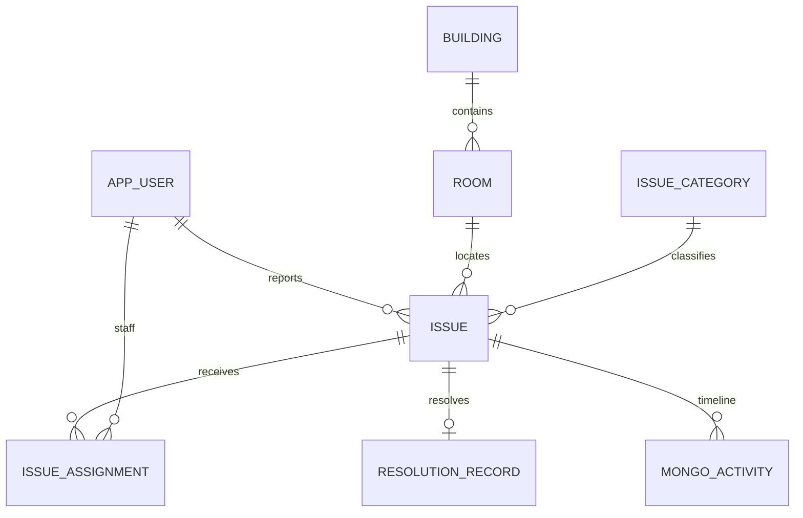

# Architecture and data choice
Browser -> Next.js UI -> Route Handlers -> PostgreSQL + MongoDB. PostgreSQL is canonical for users, facilities, assignments, issues and resolutions because relationships and state transitions need constraints and transactions. MongoDB stores evolving issue activity events with flexible metadata. The current design cannot atomically commit across both stores; production should write an outbox record in PostgreSQL and asynchronously deliver idempotently to MongoDB.

## ER model

## Advanced database features
Transactions, queue view, guarded stored function, timestamp/version trigger, partial/composite indexes, JOIN/GROUP BY/HAVING/aggregate/subquery examples, Mongo event aggregation and indexes. Role enum: STUDENT, STAFF, ADMIN. API must derive actor identity from authenticated sessions; demo identifiers are not secure authentication.
